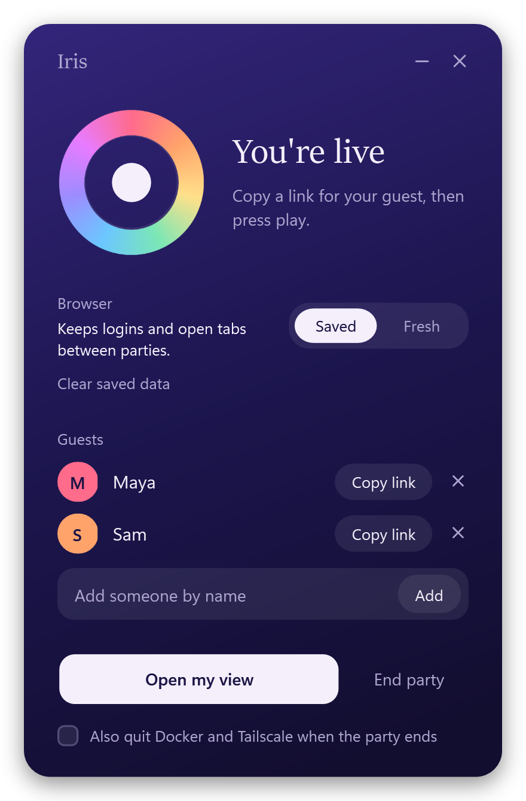

# Iris

A private watch party. Iris runs one shared Chrome on this laptop and streams it to you and your
guests, so everyone sees the same thing and anyone can pause, seek, click or type. It works on any
website because it shares the whole browser, not just a video player.

Named after the Greek goddess of the rainbow, messenger of the gods.

## Setting it up

You need Windows 11 with [Docker Desktop](https://www.docker.com/products/docker-desktop/) and
[Tailscale](https://tailscale.com/download) installed and signed in, and
[HTTPS certificates](https://tailscale.com/kb/1153/enabling-https) turned on for your tailnet. An
NVIDIA graphics card with a recent driver is optional and gives 60 fps. If you use other WSL
distros, make sure none runs its own time service; it warps Docker's clock and makes video stutter
(see [WSL clock](docs/TROUBLESHOOTING.md#wsl-clock)).

1. Download or clone this folder somewhere permanent.
2. In PowerShell, in the folder: `powershell -ExecutionPolicy Bypass -File .\Iris.ps1 -Install`.
   This adds Iris to the Start menu and the desktop. Right-click it in Start to pin it.
3. Open Iris. The first start downloads the shared browser (a few GB) and creates `people.json`
   with a host account called `Host` and a random password. Change the name there if you like,
   while Iris is closed.

## Using it

1. Open **Iris** (Desktop shortcut, or press the Windows key and type `Iris`).
2. Wait for the ring to fill and the window to say **You're live**. Your browser opens your view,
   already signed in as the host.
3. Click **Copy link** next to a guest and paste it to them. They click the link and they are in.
4. Click the video to take control. Anyone can; you just take turns.
5. Click **End party** when you are done.

Closing the window asks whether to end the party or leave it running. If you leave it running,
opening Iris again reattaches to it.

You never need to open Docker Desktop or Tailscale yourself: Iris starts both. Tick **Also quit
Docker and Tailscale when the party ends** to have them closed again afterwards. This frees
Docker's memory, and this laptop leaves your tailnet until Iris (or you) opens Tailscale again.
Ending then takes about 30 seconds.

## Saved or Fresh

The **Browser** switch in the window picks how the shared Chrome behaves between parties.

| | Saved | Fresh |
|---|---|---|
| Logins, cookies, open tabs | Kept. Chrome reopens where you left off | Gone. Every party starts empty |
| Good for | Picking up a show where you stopped, staying signed in to streaming sites | Browsing you don't want remembered |
| How | A kept profile on disk (Docker volume `iris_profile`) | Chrome's guest mode in a throwaway container |

- Switching while live restarts the shared browser, which takes about 20 seconds. Everyone then
  refreshes their page.
- Switching to Fresh does not delete anything saved; switching back to Saved brings it all back.
- **Clear saved data** (click twice) deletes the saved profile for good.

## Picture and sound

Video is 1080p at up to 60 fps, encoded on the laptop's NVIDIA graphics card at 10 Mbps per
viewer, with 192 kbps audio. Chrome was chosen because it plays DRM-protected video (paid streaming
sites) and Firefox in this setup cannot. If the graphics card is unavailable, Iris falls back to
CPU encoding at 30 fps and says so in the window. Measurements are in
[docs/PERFORMANCE.md](docs/PERFORMANCE.md).

## Inviting someone new

Two separate things have to be true before a guest can join:

1. **They can reach this laptop.** Share the laptop with them in Tailscale (one time per person).
2. **They have an Iris account.** Type their name in the Iris window and click **Add**.

Full steps, including the message to send them, are in [docs/GUESTS.md](docs/GUESTS.md).

## What is in this folder

| Path | What it is |
|---|---|
| `Iris.ps1` | The app: the window, startup and shutdown, modes, guest management. `-Install` adds shortcuts, `-Stop` stops everything |
| `ui/Iris.xaml` | The window's layout and styling |
| `docker-compose.yaml` | The shared browser (CPU fallback settings) and its network lockdown |
| `stack/gpu.yaml` | Layered on when the NVIDIA card is available: GPU image and encoder |
| `stack/saved.yaml` | Layered on in Saved mode: kept profile, policy and launch flags |
| `stack/chrome-saved-*` | Saved-mode Chrome policy and launch settings (one per image) |
| `settings.json` | The chosen mode, `saved` or `fresh` (created on first start) |
| `people.json` | You (the host) and your guests, with their passwords (created on first start, never committed) |
| `data/members.json` | Generated from `people.json`; the hashed accounts the shared browser reads |
| `assets/` | The app icon and the ring artwork shown in the window |
| `tools/` | Benchmark and test scripts (see PERFORMANCE.md) |
| `.env` | Generated on each start: Tailscale address, mode and encoder |
| `docs/` | How it works, guests, performance, troubleshooting |

## More

- [docs/ARCHITECTURE.md](docs/ARCHITECTURE.md): how it works, the security model, and why each decision was made.
- [docs/PERFORMANCE.md](docs/PERFORMANCE.md): benchmark results and how to rerun them.
- [docs/GUESTS.md](docs/GUESTS.md): adding, inviting and removing guests.
- [docs/TROUBLESHOOTING.md](docs/TROUBLESHOOTING.md): fixes, maintenance, and how to test it.

## Credits

- [neko](https://github.com/m1k1o/neko) by m1k1o and contributors does the hard part: the shared
  browser, its streaming and the viewer page. Iris is a launcher and lockdown around it.
- [Tailscale](https://tailscale.com) provides the private network, [Docker](https://www.docker.com)
  the containers, and [GStreamer](https://gstreamer.freedesktop.org) with NVIDIA NVENC the encoding.
- Built with the help of AI: Claude (Anthropic) wrote most of the code, ran the benchmarks and
  security tests, and drafted these docs, directed and reviewed by the author.

## License

MIT, see [LICENSE](LICENSE). neko and the browser images it runs keep their own licenses.
